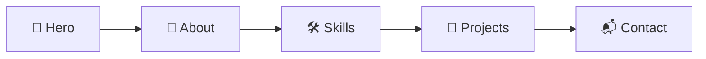

<div align="center">


<br/>


### [🌐 Live Demo](izyan.yyz.my.id) · [🐛 Lapor Bug](https://github.com/TheyanzXD/Japanstyles-portofolio/issues) · [💡 Request Fitur](https://github.com/TheyanzXD/Japanstyles-portofolio/issues)

</div>

---

## 🧭 Navigasi Cepat

| | | | |
|:-:|:-:|:-:|:-:|
| [📖 Tentang](#-tentang-proyek) | [✨ Fitur](#-fitur) | [🛠️ Tech Stack](#️-tech-stack) | [🚀 Instalasi](#-instalasi--menjalankan) |
| [📂 Struktur](#-struktur-folder) | [🎨 Palet Warna](#-palet-warna) | [☁️ Deploy](#️-deploy) | [🤝 Kontribusi](#-kontribusi) |

---

## 📖 Tentang Proyek

**Japanstyles Portofolio** adalah website portofolio pribadi dengan sentuhan estetika Jepang: bersih, minimalis, penuh ketenangan, dan detail yang disengaja. Proyek ini dibuat untuk memamerkan karya, skill, dan informasi kontak dalam tampilan yang elegan.

> 🌸 *「継続は力なり」* — **Keizoku wa chikara nari**
> "Konsistensi adalah kekuatan."

---

## ✨ Fitur

<table>
  <tr>
    <td width="50%">

### 🎌 Tema Jepang
Tipografi, warna, dan ornamen terinspirasi budaya Jepang.

    </td>
    <td width="50%">

### 📱 Responsive
Nyaman dilihat di HP, tablet, maupun desktop.

    </td>
  </tr>
  <tr>
    <td>

### ⚡ Ringan & Cepat
Dioptimalkan agar loading terasa instan.

    </td>
    <td>

### 🎬 Animasi Halus
Transisi dan efek scroll yang lembut, tidak berlebihan.

    </td>
  </tr>
</table>

<details>
<summary><b>🔍 Lihat semua fitur (klik untuk membuka)</b></summary>

<br/>

- [x] Hero section dengan sambutan bertema Jepang
- [x] Section **About** / tentang saya
- [x] Section **Skills**
- [x] Section **Projects**
- [x] Section **Contact**
- [x] Tampilan responsive
- [ ] Mode gelap / terang *(opsional, sesuaikan)*
- [ ] Multi-bahasa ID / JP *(opsional, sesuaikan)*

</details>

---

## 🛠️ Tech Stack

> ⚠️ Sesuaikan badge di bawah dengan teknologi yang benar-benar kamu pakai.

<div align="center">


</div>

---

## 🚀 Instalasi & Menjalankan

<details open>
<summary><b>💻 Jalankan secara lokal</b></summary>

<br/>

```bash
# 1. Clone repositori
git clone https://github.com/TheyanzXD/Japanstyles-portofolio.git

# 2. Masuk ke folder proyek
cd Japanstyles-portofolio

# 3. Buka index.html di browser
#    atau jalankan server lokal:
npx serve .
```

Lalu buka `http://localhost:3000` di browser. 🎉

</details>

<details>
<summary><b>📦 Jika memakai Node.js / npm</b></summary>

<br/>

```bash
npm install
npm run dev
```

</details>

---

## 📂 Struktur Folder

```text
Japanstyles-portofolio/
├── 📁 assets/        # Gambar, ikon, font
├── 📁 css/           # Stylesheet
├── 📁 js/            # Script interaksi
├── 📄 index.html     # Halaman utama
├── 📄 README.md      # Dokumentasi ini
└── 📄 LICENSE        # Lisensi
```

> ✏️ Sesuaikan dengan struktur asli repositori kamu.

---

## 🎨 Palet Warna

| Warna | Nama | Hex |
|:-:|:--|:--|
|  | Sakura (桜) | `#FF6B9D` |
|  | Aka / Merah Torii (赤) | `#C0392B` |
|  | Yoru / Malam (夜) | `#1A1A2E` |
|  | Washi / Kertas (和紙) | `#F5F0E6` |
|  | Kin / Emas (金) | `#FFD700` |

---

## 🔄 Alur Website



---

## ☁️ Deploy

<details>
<summary><b>▲ Deploy ke Vercel</b></summary>

<br/>

1. Push repositori ke akun GitHub kamu
2. Buka [vercel.com/new](https://vercel.com/new)
3. Import repositori `Japanstyles-portofolio`
4. Klik **Deploy** 🚀

</details>

<details>
<summary><b>🐙 Deploy ke GitHub Pages</b></summary>

<br/>

1. Buka **Settings → Pages**
2. Pilih branch `main` dan folder `/ (root)`
3. Klik **Save**, tunggu beberapa menit

</details>

---

## 🤝 Kontribusi

Kontribusi, ide, dan saran sangat diterima! 🌸

1. **Fork** repositori ini
2. Buat branch fitur: `git checkout -b fitur/nama-fitur`
3. Commit perubahan: `git commit -m "Tambah fitur keren"`
4. Push ke branch: `git push origin fitur/nama-fitur`
5. Buka **Pull Request**

---

## 📄 Lisensi

Proyek ini dilisensikan di bawah **MIT License**. Lihat file [LICENSE](LICENSE) untuk detail.

---

## 📬 Kontak

<div align="center">

[](https://github.com/TheyanzXD)
[](mailto:EMAIL_KAMU)
[](https://instagram.com/USERNAME_KAMU)

<br/>

⭐ **Kalau suka proyek ini, jangan lupa kasih bintang ya!** ⭐

<br/>

Dibuat dengan 💖 dan 🍵 oleh **[TheyanzXD](https://github.com/TheyanzXD)**


</div>
